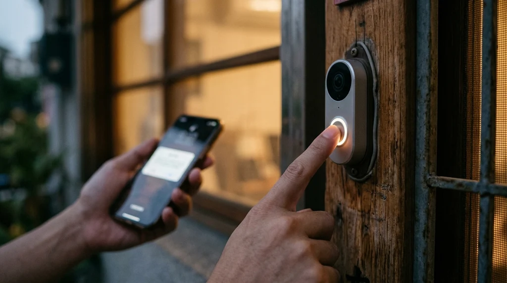

```{=html}
<article class="detail">
<header class="detail-head reveal-fx">
<span class="badge badge-pilot">預約試上</span> <span class="badge badge-cat">生活與家庭</span>
<h1>AIoT 入門，從一顆門鈴按鍵開始</h1>
<p class="detail-tagline">想讓家裡聰明一點，一看到電路板和程式就想放棄</p>
<p class="detail-audience">適合：想入門智慧家庭的生活玩家、想評估感測應用的工作者</p>
<p class="detail-axes">這門課練的能力：<a class="axis-chip axis-chip-sm" href="/method/#axis-b">B 把資料變成系統</a><a class="axis-chip axis-chip-sm" href="/method/#axis-d">D 讓 AI 自動運轉</a></p>
<a class="btn-primary" href="/apply/?course=aiot-button">預約試上</a>
</header>

<section class="detail-block reveal-fx">
<h2>這門課的情境</h2>
<p>從一顆實體按鍵開始：按下門鈴，訊號先到你的 AI 助手，由它照你定的規則通知家人、記下到訪紀錄——一堂課走完「實體訊號到 AI 行動」的完整路徑。</p>
</section>
<section class="detail-block reveal-fx">
<h2>你會做出什麼（可帶走的作品）</h2>
<ul class="detail-gains"><li>按下去就通知 AI 助手、由它轉知家人的門鈴按鍵</li><li>AI 助手自動整理的到訪紀錄表</li><li>一份自己改得動的自動化規則</li></ul>
</section>
<section class="detail-block reveal-fx">
<h2>會用到的 AI 技巧</h2>
<ul class="detail-gains"><li>把實體按鍵連上網路的現成模組（課堂提供，不用焊接）</li><li>按鍵事件傳給 AI 助手（Agent）的串接方法</li><li>用白話規則決定 AI 助手收到訊號後做什麼：通知、記錄、回覆</li></ul>
</section>
<section class="detail-block reveal-fx">
<h2>你會帶走的能力</h2>
<p>感測訊號理解、事件流程設計、自動化規則撰寫、裝置與 AI 的串接思維</p>
</section>
<section class="detail-block reveal-fx">
<h2>之後可以往哪走</h2>
<p>智慧家庭應用玩家、AIoT 導入種子人才；進階可銜接企業用電異常偵探實戰班，把同一套訊號到行動的思維，用在工廠與辦公室的用電資料上。</p>
</section>
<section class="detail-block reveal-fx">
<h2>這門課背後的真實系統</h2>
<p>課堂使用的按鍵模組與通知流程，來自實際部署中的感測專案經驗</p>
<a href="/projects/">看全部運行中的專案 →</a>
</section>
<section class="detail-block detail-limits reveal-fx">
<h2>誠實界線</h2>
<p>單堂課完成的是一顆按鍵到通知的最小流程，不含整屋智慧家庭佈建；長期穩定運行需要家中電源與網路環境配合。</p>
</section>
<section class="detail-block reveal-fx">
<h2>常見問題</h2>
<div class="faq-list"><div class="faq-item"><h3>需要自己買設備嗎？</h3><p>不需要。課堂提供練習用的按鍵模組；想帶回家延伸使用，課堂會說明選購方式，屬於入門等級的零件。</p></div><div class="faq-item"><h3>完全不懂電子和程式可以參加嗎？</h3><p>可以。模組是現成的，不用焊接也不用寫程式。你的工作是定義規則：按下按鍵之後，AI 助手要通知誰、記錄什麼。</p></div><div class="faq-item"><h3>跟企業用電異常偵探實戰班什麼關係？</h3><p>這門是入口課，練的是實體訊號到 AI 行動的基本功；偵探實戰班把同一套思維放大到企業的用電資料與異常偵測，適合上完這門再走。</p></div></div>
</section>
<section class="detail-block reveal-fx">
<a class="btn-primary" href="/apply/?course=aiot-button">預約試上</a>
<p>小班體驗場陸續安排，時間、時數與費用會在通知信中說明，登記後依序通知。</p>
<p class="detail-cta-note">不方便填表單？直接寫信到 ai@cooperation.tw，標題註明「試上申請：AIoT 入門，從一顆門鈴按鍵開始」。</p>
</section>
<script type="application/ld+json">{"@context": "https://schema.org", "@graph": [{"@type": "Course", "name": "AIoT 入門，從一顆門鈴按鍵開始", "description": "給智慧家庭入門者的 AIoT 實作課：用現成模組把實體門鈴按鍵接上你的 AI 助手，按一下就通知家人、自動記錄到訪，不用焊接不用寫程式。", "url": "https://cooperation.tw/courses/aiot-button.html", "provider": {"@type": "Organization", "name": "AI Cooperation", "url": "https://cooperation.tw"}, "hasCourseInstance": {"@type": "CourseInstance", "courseMode": "onsite"}}, {"@type": "BreadcrumbList", "itemListElement": [{"@type": "ListItem", "position": 1, "name": "首頁", "item": "https://cooperation.tw/"}, {"@type": "ListItem", "position": 2, "name": "課程", "item": "https://cooperation.tw/courses/"}, {"@type": "ListItem", "position": 3, "name": "AIoT 入門，從一顆門鈴按鍵開始", "item": "https://cooperation.tw/courses/aiot-button.html"}]}, {"@type": "FAQPage", "mainEntity": [{"@type": "Question", "name": "需要自己買設備嗎？", "acceptedAnswer": {"@type": "Answer", "text": "不需要。課堂提供練習用的按鍵模組；想帶回家延伸使用，課堂會說明選購方式，屬於入門等級的零件。"}}, {"@type": "Question", "name": "完全不懂電子和程式可以參加嗎？", "acceptedAnswer": {"@type": "Answer", "text": "可以。模組是現成的，不用焊接也不用寫程式。你的工作是定義規則：按下按鍵之後，AI 助手要通知誰、記錄什麼。"}}, {"@type": "Question", "name": "跟企業用電異常偵探實戰班什麼關係？", "acceptedAnswer": {"@type": "Answer", "text": "這門是入口課，練的是實體訊號到 AI 行動的基本功；偵探實戰班把同一套思維放大到企業的用電資料與異常偵測，適合上完這門再走。"}}]}]}</script>
<p class="detail-back"><a href="/courses/">← 回課程探索</a></p>
</article>
```
